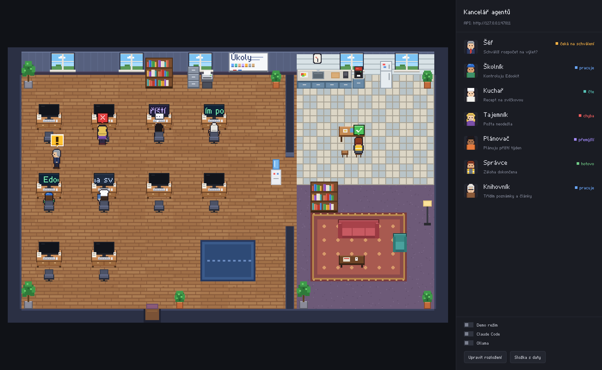
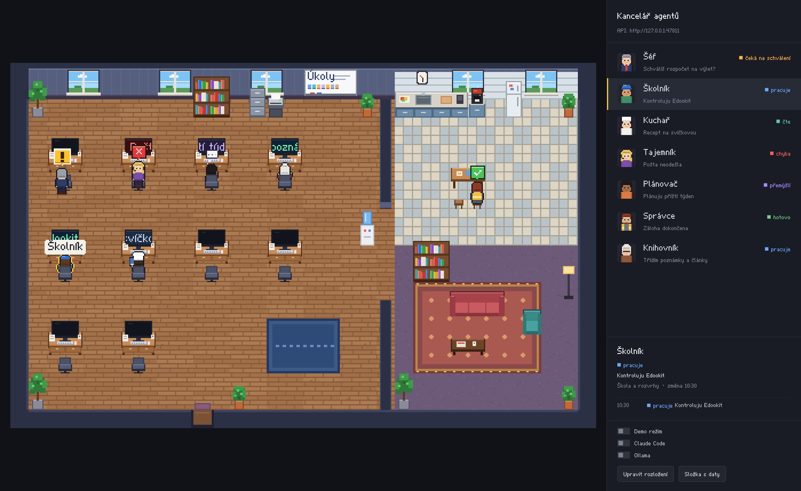
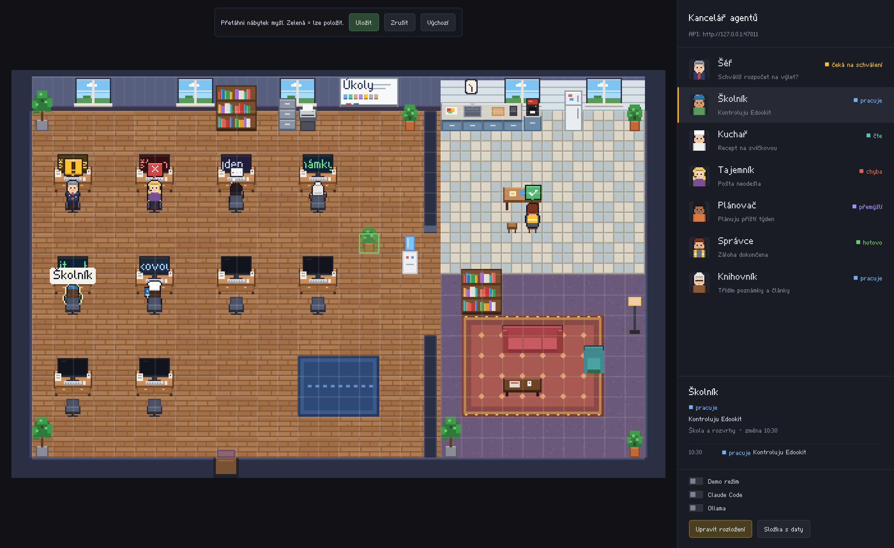
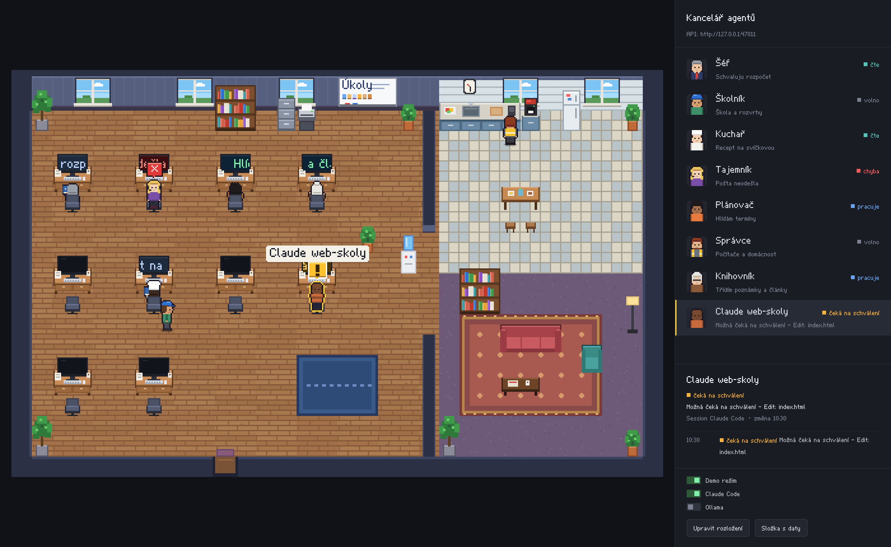

# Kancelář agentů

Desktopová aplikace pro macOS (Apple Silicon): pixel-art kancelář v pohledu shora, kde vidíš,
co právě dělají tvoji agenti. Agenti chodí po kanceláři, sedají si ke stolům, a když nemají
práci, odejdou do kuchyňky nebo do odpočinkové zóny. Nápad vychází z projektu
[Pixel Agents](https://github.com/pablodelucca/pixel-agents). Kód ani grafika z něj ale
převzaté nejsou (viz [Autoři a licence](#autoři-a-licence)).



| Vybraný agent a historie | Editor rozložení | Session Claude Code |
|---|---|---|
|  |  |  |

## Co umí

- **Agenti:** Šéf, Školník, Kuchař, Tajemník, Plánovač, Správce a Knihovník. Každý má jiný vzhled.
- **Stavy:** volno, pracuje, čte, přemýšlí, čeká na schválení, hotovo a chyba.
  - Při práci, čtení, přemýšlení, čekání a chybě jde postava ke svému stolu.
  - Ve stavu volno a hotovo odchází do kuchyňky nebo do odpočinkové zóny.
  - Cestu si postavy hledají samy (A*).
- **Pózy:** postava sedí a píše, čte knihu, přemýšlí s rukou u hlavy, stojí nebo čeká
  s překříženýma rukama. Chodí ve 4 směrech.
- **Bubliny nad hlavou:**
  - čeká na schválení: velká žlutá bublina s „!“, poskakuje a bliká,
  - chyba: červená bublina s křížkem,
  - hotovo: zelená bublina s odškrtnutím,
  - přemýšlí: bublina s tečkami.
- **Monitory** ukazují text úkolu jako běžící řádek. Barva obrazovky odpovídá stavu.
- **Nábytek:**
  - stoly s monitory a židle,
  - kuchyňka: linka, kávovar, lednice a jídelní stůl,
  - odpočinková zóna: pohovka, křeslo, stolek a koberec,
  - dále rostliny, knihovny, tabule s úkoly, okna (obloha podle denní doby), hodiny se skutečným časem a barel s vodou.
- **Editor rozložení:** přes tlačítko *Upravit rozložení* nebo ⌘E přetáhneš nábytek myší.
  Zelená znamená, že předmět jde položit, červená, že ne. Rozložení se uloží do `layout.json`.
- **Boční panel:** seznam agentů. Kliknutí na agenta (v panelu nebo přímo na postavu)
  zvýrazní jeho postavu a ukáže historii.
- **Pixelové písmo** *Kancl Pixel* je vlastní a obsahuje českou diakritiku. Na plátně se kreslí
  po pixelech, v panelu se používá stejné písmo jako TTF.
- **Ostrý pixel art:** Canvas 2D, dlaždice 16×16, celočíselné zvětšení přepočtené
  na fyzické pixely displeje a `image-rendering: pixelated`.

## Stažení, sestavení a spuštění

Potřebuješ Mac s Apple Silicon, [Node.js](https://nodejs.org) 20 nebo novější a Git.

```bash
git clone https://github.com/<tvuj-ucet>/kancelar-agentu.git
```

```bash
cd kancelar-agentu
```

```bash
npm install
```

Spuštění pro vývoj:

```bash
npm start
```

Sestavení `.app` a `.dmg` (vznikne ve složce `dist/`):

```bash
npm run build:mac
```

Výsledek:
- `dist/Kancelar-Agentu-1.0.0-arm64.dmg`: instalační obraz,
- `dist/Kancelar-Agentu-1.0.0-arm64-mac.zip`: zabalená aplikace,
- `dist/mac-arm64/Kancelar Agentu.app`: samotná aplikace.

Otevři `.dmg` a přetáhni *Kancelar Agentu* do složky *Aplikace*.

Internet je potřeba jen při `npm install` a při prvním sestavení (stažení Electronu).
Hotová aplikace pak funguje bez internetu.

### První spuštění nepodepsané aplikace

Aplikace není podepsaná certifikátem Apple Developer ani notarizovaná, takže ji macOS
napoprvé zablokuje. Na Apple Silicon dostane při sestavení jen lokální „ad-hoc“ pečeť
(`codesign -s -`, žádný certifikát), bez které by se nespustila vůbec.

Postup:
1. Ve Finderu otevři *Aplikace*, klikni na **Kancelar Agentu** pravým tlačítkem a zvol **Otevřít**.
2. V dialogu znovu zvol **Otevřít**.

Když dialog nabízí jen „Přesunout do koše“ (macOS 15 a novější):
1. Zkus aplikaci jednou normálně otevřít.
2. Jdi do **Nastavení systému → Soukromí a zabezpečení**.
3. Dole u hlášky o aplikaci Kancelář agentů klikni na **Přesto otevřít** a potvrď heslem.

Pokud macOS hlásí, že je aplikace „poškozená“, odstraň příznak karantény z internetu:

```bash
xattr -dr com.apple.quarantine "/Applications/Kancelar Agentu.app"
```

Pak už se aplikace spouští normálně.

## Napojení agentů

Lokální server běží uvnitř aplikace a poslouchá jen na `127.0.0.1`.
Výchozí port je 47800; když je obsazený, aplikace zkusí další. Skutečný port najdeš
v panelu nahoře a v souboru `server.json` ve složce s daty. API i příkaz `kancelar`
fungují, jen dokud je aplikace otevřená.

### Příkaz `kancelar`

```bash
./kancelar status skolnik working "Kontroluju Edookit"
```

```bash
./kancelar status Šéf "čeká na schválení" "Schválíš rozpočet?"
```

```bash
./kancelar list
```

Příkaz je ve složce repozitáře a je přibalený i v aplikaci:
`/Applications/Kancelar Agentu.app/Contents/Resources/kancelar`. Stačí mu `bash` a `curl`,
které má macOS v základu. Port si přečte ze `server.json` (nebo z proměnné `KANCELAR_PORT`).

Návratové kódy: `0` = OK, `1` = chyba v požadavku (neznámý agent nebo stav), `2` = aplikace neběží.

### HTTP API

```bash
curl -X POST http://127.0.0.1:47800/api/agents/skolnik/status -H 'Content-Type: application/json' -d '{"state":"working","task":"Kontroluju Edookit"}'
```

| Metoda | Adresa | Popis |
|---|---|---|
| `POST` | `/api/agents/:id/status` | tělo `{"state": "...", "task": "..."}` |
| `GET` | `/api/agents` | všichni agenti a jejich stav |
| `GET` | `/api/agents/:id` | jeden agent |
| `GET` | `/api/agents/:id/history?limit=50` | historie |
| `GET` | `/api/health` | kontrola, že aplikace běží |

Identifikátory agentů: `sef`, `skolnik`, `kuchar`, `tajemnik`, `planovac`, `spravce`, `knihovnik`.
Funguje i české jméno s diakritikou (`Školník`).

| Stav | Česky (také přijímáno) |
|---|---|
| `idle` | `volno` |
| `working` | `pracuje` |
| `reading` | `čte` |
| `thinking` | `přemýšlí` |
| `waiting` | `čeká na schválení` |
| `done` | `hotovo` |
| `error` | `chyba` |

Ochrana proti požadavkům z webových stránek:
- požadavky s hlavičkou `Origin` (tedy z prohlížeče) jsou odmítnuté,
- odmítnutý je i cizí `Host` (ochrana proti DNS rebindingu),
- `POST` vyžaduje `Content-Type: application/json`,
- tělo požadavku má limit 16 kB.

### Volitelné zdroje (jen pro čtení)

Zapínají se přepínači v panelu nebo v menu **Kancelář**:

- **Claude Code:** aplikace čte transkripty v `~/.claude/projects/*/*.jsonl`.
  - Každá session změněná během posledních 10 minut dostane vlastní postavu a sedne si k volnému stolu.
  - Stav se odhaduje z konce transkriptu. Čtení souborů je čtení, úprava souborů nebo příkaz je práce.
  - Příkaz nebo úprava, které 10 s nedostaly výsledek, se zobrazí jako „možná čeká na schválení“.
  - Odpověď bez nástroje se zobrazí jako hotovo.
  - Soubory se nikdy nemění.
- **Ollama:** aplikace se ptá `http://127.0.0.1:11434/api/ps`. Každý načtený model dostane postavu.
- **Demo režim:** agenti sami střídají úkoly a stavy.

## Data

Data jsou ve složce `~/Library/Application Support/Kancelar Agentu`.
Otevřeš ji přes menu **Soubor → Otevřít složku s daty** (⇧⌘O) nebo tlačítkem v panelu.

| Soubor | Obsah |
|---|---|
| `state.json` | aktuální stav a úkol každého agenta |
| `history.jsonl` | historie změn, jeden JSON na řádek; nad 2 MB se přesune do `history.1.jsonl` |
| `layout.json` | uložené rozložení nábytku (smazáním se vrátí výchozí) |
| `settings.json` | přepínače demo, Claude Code a Ollama |
| `server.json` | port běžícího API (po ukončení aplikace se smaže) |
| `Chromium/` | interní mezipaměti Electronu |

## Bezpečnost

- `contextIsolation: true`, `nodeIntegration: false`, `sandbox: true`, `webSecurity: true`.
  Stránka má k dispozici jen úzké rozhraní z `preload.js`.
- Načíst se smí jen lokální soubory aplikace. Ostatní požadavky ruší `webRequest` v hlavním procesu.
  Content-Security-Policy navíc zakazuje `connect-src`.
- Navigace, nová okna, `<webview>` a všechna oprávnění (kamera, notifikace…) jsou zakázané.
- Všechny knihovny, písma a grafika jsou přímo v projektu. Aplikace nemá žádné běhové
  npm závislosti, jen Electron.

## Vývoj

```bash
npm test
```

Testy pokrývají API, příkaz `kancelar`, ukládání, A*, editor rozložení a čtení transkriptů Claude Code.

```bash
xvfb-run -a node scripts/screenshots.js docs/screenshots
```

Skript spustí aplikaci, nastaví stavy a uloží snímky. Na Macu stačí `node scripts/screenshots.js`.
Potřebuje balíček `playwright`.

Další skripty:
- `npm run make:font` znovu vygeneruje `KanclPixel.ttf` z dat v `src/renderer/font-data.js`
  (potřebuje Python s `fonttools`).
- `npm run make:icon` znovu nakreslí `build/icon.png`.

Struktura:

```
src/main/        hlavní proces: okno, menu, API server, úložiště, demo, integrace
src/preload/     bezpečný most mezi stránkou a hlavním procesem
src/renderer/    kancelář: písmo, spritey, dlaždice, A*, simulace, editor, panel
scripts/         generátory písma a ikony, snímky obrazovky, after-pack
kancelar         příkaz pro terminál
```

## Autoři a licence

Projekt je pod licencí MIT (soubor `LICENSE`).

Všechny postavy, dlaždice, nábytek, ikona i písmo *Kancl Pixel* jsou nakreslené kódem
přímo v tomto projektu. Grafiku vykreslují `sprites.js`, `render.js` a `make-icon.js`.
Z projektu [Pixel Agents](https://github.com/pablodelucca/pixel-agents) (MIT, jeho autoři a přispěvatelé) je převzatý jen nápad:
kancelář v pixel artu, kde postavy znázorňují agenty. Žádný kód ani obrázky převzaté nejsou.
Placená sada Donarg ani jiné cizí sady použité nejsou.
